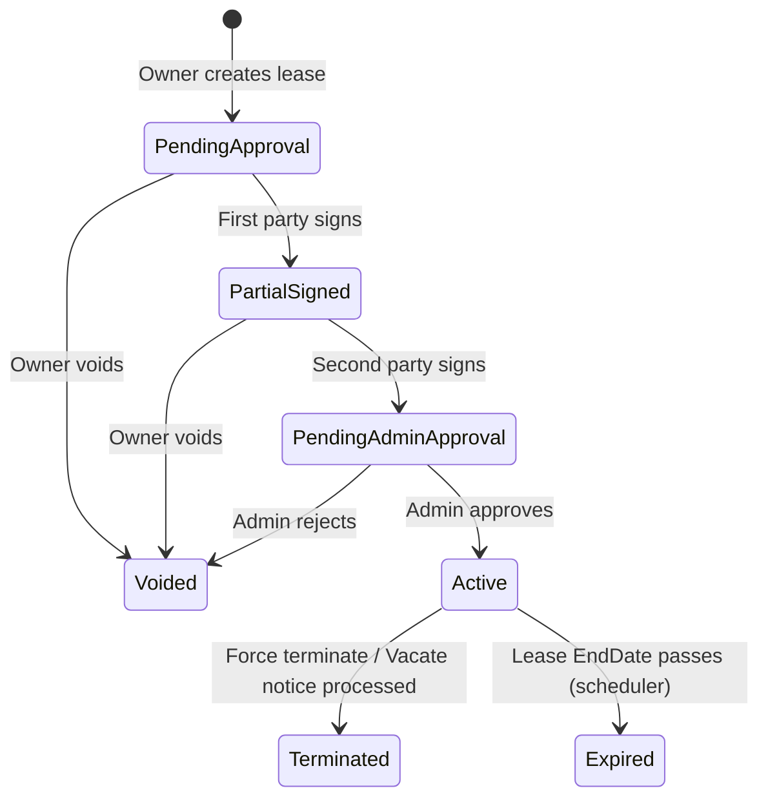
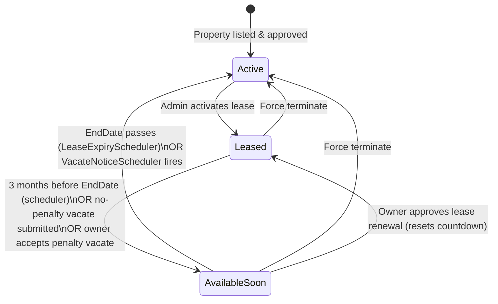
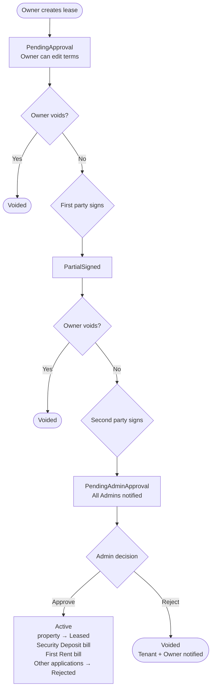
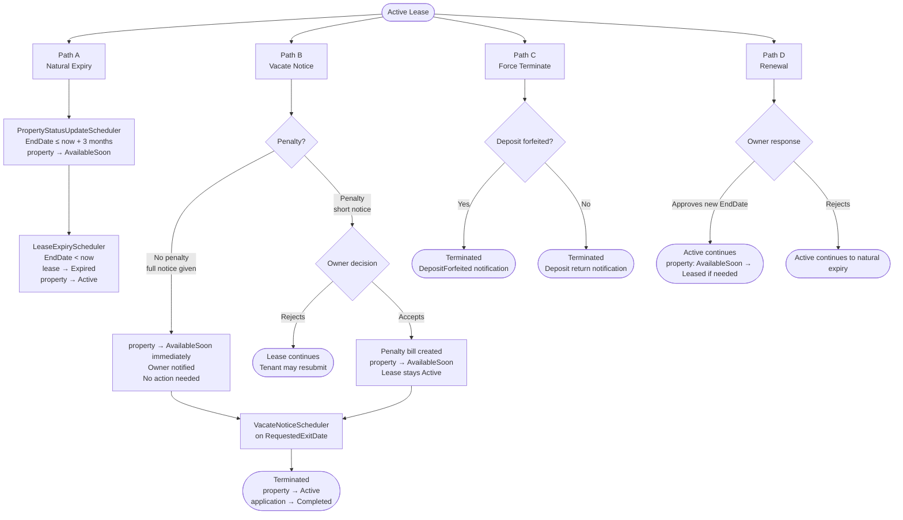
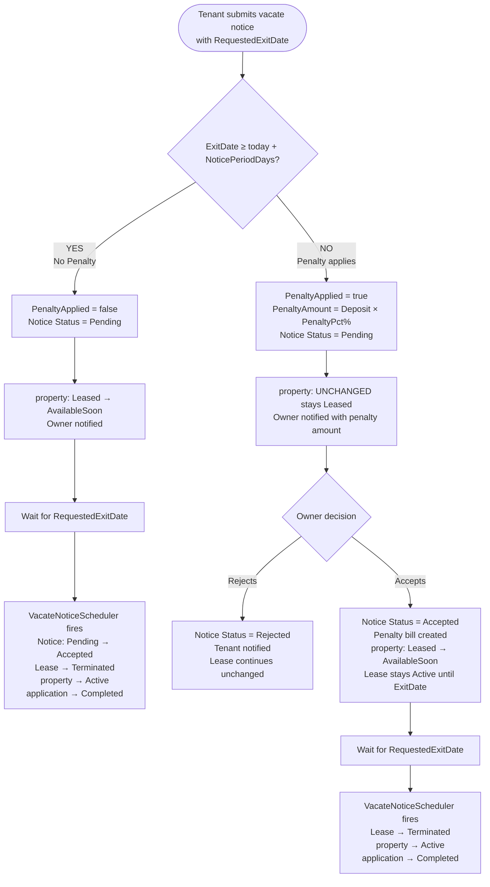
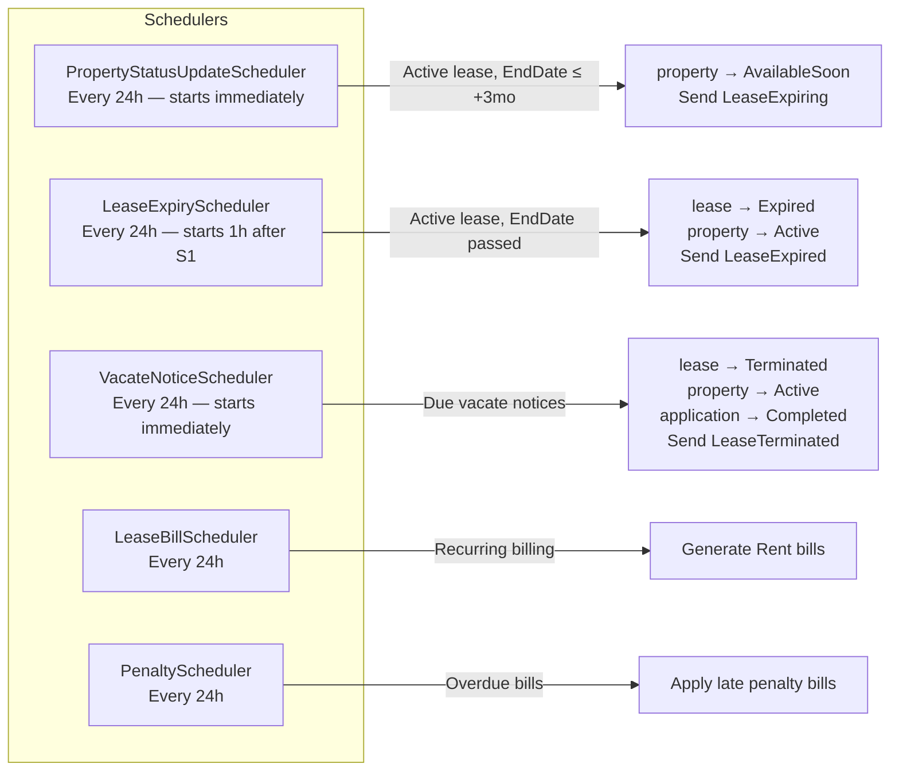

# EstateSync — Lease & Property Status Flows

---

## Lease Status State Machine

---

## Property Status Transitions

---

## Full Lease Lifecycle — Creation to Activation

---

## Active Lease — All End Paths

---

## Path B Deep Dive — Vacate Notice

**What the scheduler query matches:**

| Notice Status | PenaltyApplied | ExitDate passed? | Action |
|---|---|---|---|
| `Pending` | `false` | ✅ Yes | Terminate (auto path) |
| `Accepted` | `true` or `false` | ✅ Yes | Terminate (owner accepted) |
| `Pending` | `true` | ✅ Yes | **Ignored** — owner hasn't responded |
| `Rejected` | any | any | **Ignored** — notice is dead |

---

## Background Schedulers

---

## Notifications Reference

| Trigger | Recipients |
|---|---|
| Lease created | Tenant |
| Both parties signed | All Admins |
| Admin approves lease | Tenant + Owner |
| Admin rejects lease | Tenant + Owner |
| Owner voids lease | Tenant |
| Lease expiring (3 months out) | Tenant + Owner |
| Lease expired naturally | Tenant + Owner |
| Vacate notice submitted | Owner |
| Vacate notice accepted | Tenant |
| Vacate notice rejected | Tenant |
| Vacate auto-processed by scheduler | Tenant + Owner |
| Force terminated | Tenant + Owner |
| Renewal requested | Owner |
| Renewal approved | Tenant |
| Renewal rejected | Tenant |
