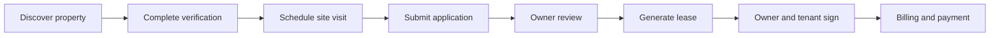
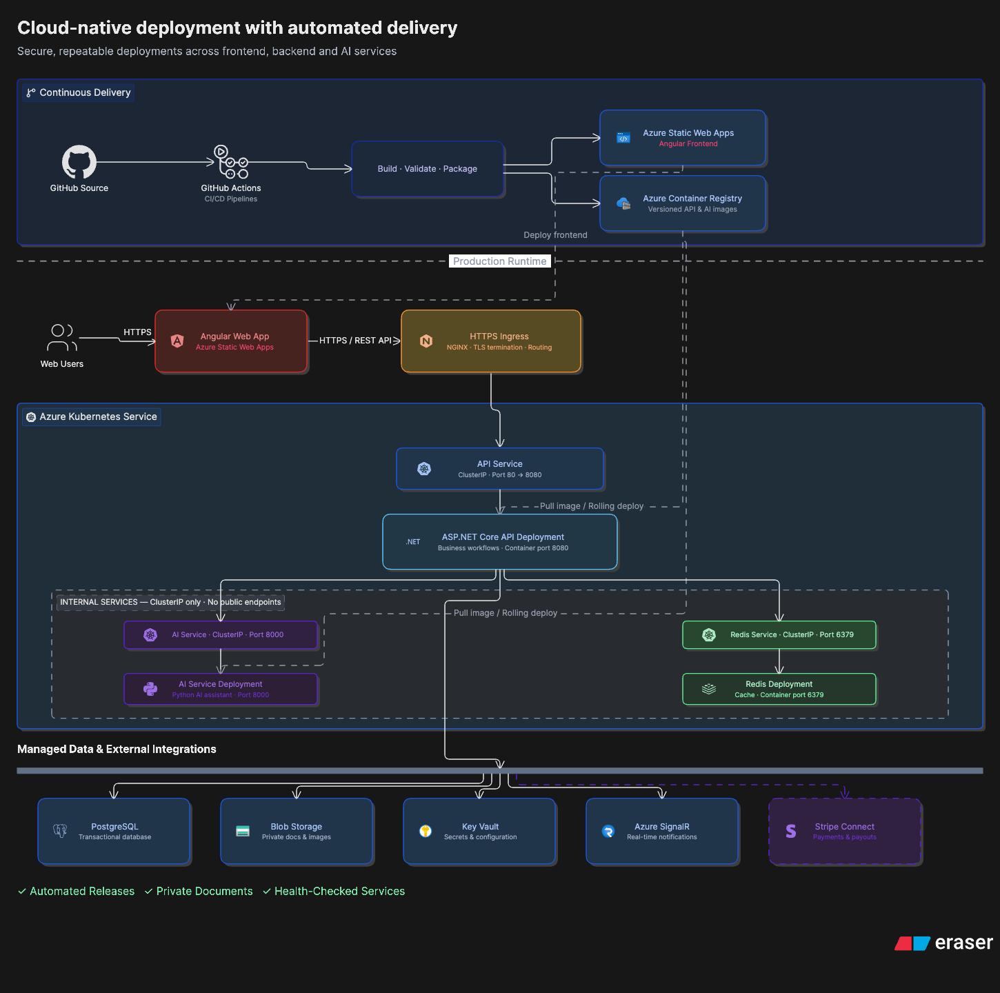

# EstateSync

**A cloud-native residential rental platform that connects tenants, property owners, and verification staff across property discovery, identity verification, rental applications, digital leases, and payments.**

EstateSync goes beyond property listing. It models the rental lifecycle as a controlled, role-based workflow, with approval gates, auditable state transitions, real-time notifications, and secure payment processing.

## Product capabilities

### Tenants

- Discover, filter, compare, and save approved properties
- Schedule and manage property site visits
- Complete KYC and financial verification
- Submit and track rental applications
- Review and digitally sign lease agreements
- View bills, complete payments, and track payment status
- Raise complaints and receive real-time notifications

### Property owners

- Complete KYC and Stripe Connect onboarding
- Create property listings with images, amenities, and documents
- Submit properties for staff approval
- Manage site visits and review rental applications
- Create, review, and digitally sign leases
- Track property, lease, billing, and settlement activity

### Administrators and verifiers

- Review KYC and financial-verification submissions
- Approve or reject property listings and leases
- Manage staff access and operational workflows
- Review audit logs and platform activity

## Rental lifecycle



Backend services enforce the user's role, resource ownership, verification status, and current workflow state. The frontend reflects those rules, but it is not treated as a security boundary.

## Technology stack

| Area | Technologies |
|---|---|
| Web application | Angular 21, Angular Material, Tailwind CSS, NgRx Signals, RxJS |
| Backend API | ASP.NET Core 10, C# 14, FluentValidation, Serilog |
| Persistence | PostgreSQL, Entity Framework Core 10 |
| Cache and temporary tokens | Redis |
| Real-time communication | ASP.NET Core SignalR, Azure SignalR Service |
| Payments | Stripe Checkout, Stripe Connect, signed webhooks |
| Documents and files | QuestPDF, Azure Blob Storage |
| AI assistance | Python, FastAPI, semantic retrieval, Anthropic Claude |
| Background processing | Hangfire with PostgreSQL storage |
| Cloud platform | Azure Kubernetes Service, Azure Static Web Apps, Azure Container Registry, Azure Key Vault |
| Delivery and infrastructure | GitHub Actions, Docker, Kubernetes, Azure Bicep |
| Testing | xUnit, Vitest, Playwright |

## Architecture

The repository contains three independently deployable applications:

- **Angular web application** — public, tenant, owner, administrator, and verifier experiences
- **ASP.NET Core API** — authentication, authorization, business workflows, persistence, payments, documents, and notifications
- **Python AI service** — documentation-grounded product assistance with role-aware, allowlisted navigation actions

The API follows a layered flow:

```text
HTTP request
    -> Controller
    -> Business service and validation
    -> Repository / Entity Framework Core
    -> PostgreSQL
```

Cross-cutting services provide authentication, audit logging, caching, file storage, email, background jobs, payment processing, and real-time notifications.

## Deployment architecture



### Production topology

| Component | Deployment target | Responsibility |
|---|---|---|
| Angular frontend | Azure Static Web Apps | Public web application and role-specific dashboards |
| ASP.NET Core API | Azure Kubernetes Service | Transactional API and business workflows |
| AI service | Azure Kubernetes Service | Internal documentation-grounded assistant |
| Container images | Azure Container Registry | Versioned API and AI service images |
| Database | Azure Database for PostgreSQL | Transactional application data |
| Cache | Redis in AKS | Temporary verification and reset-token storage |
| File storage | Azure Blob Storage | Private property, identity, and lease documents |
| Secrets | Azure Key Vault | Runtime credentials and protected configuration |
| Real-time messaging | Azure SignalR Service | Scalable notification delivery |
| Payments | Stripe | Hosted checkout, connected accounts, and webhook events |

The API and AI service are private containerized workloads with readiness and liveness probes. NGINX Ingress terminates TLS and routes external API traffic. Internal services use Kubernetes `ClusterIP` endpoints and are not exposed publicly.

Infrastructure is defined as modular Bicep templates under [`infra/`](infra/), while Kubernetes workloads are defined under [`infra/k8s/`](infra/k8s/).

## Continuous delivery

Three GitHub Actions workflows deploy components independently when their paths change:

```text
Frontend change
    -> Angular production build
    -> Azure Static Web Apps

Backend change
    -> Docker build
    -> Commit-SHA image tag
    -> Azure Container Registry
    -> AKS rolling deployment

AI service change
    -> Docker build
    -> Commit-SHA image tag
    -> Azure Container Registry
    -> AKS rolling deployment
```

Backend and AI deployments wait for Kubernetes rollout completion. Workflow concurrency prevents overlapping production deployments of the same service.

## Security decisions

- Stripe hosts the payment interface; EstateSync does not directly process card details.
- A signed Stripe webhook—not the browser redirect—is the source of truth for payment completion.
- JWT authentication and role-based authorization protect API endpoints.
- Backend services validate resource ownership and permitted workflow transitions.
- Passwords are hashed with BCrypt.
- Verification and password-reset tokens are short-lived and stored in Redis.
- Production secrets are loaded from Azure Key Vault and are not embedded in container images.
- Private documents are stored in Azure Blob Storage and accessed through controlled URLs.
- Audit records capture security-sensitive and operational changes.

## Repository structure

```text
.
├── backend/
│   ├── EstateSync.Api/          # ASP.NET Core API
│   └── EstateSync.Tests/        # Backend test suite
├── frontend/
│   └── estatesync-ui/           # Angular application
├── ai-service/                  # FastAPI retrieval-augmented assistant
├── infra/
│   ├── modules/                 # Modular Azure Bicep resources
│   ├── k8s/                     # Kubernetes workloads and networking
│   └── parameters/              # Safe deployment parameter template
├── .github/workflows/           # Component deployment pipelines
├── postman/                     # API flow collections
├── tools/                       # Operational and data-seeding utilities
└── EstateSync.sln
```

## Local development

### Prerequisites

- .NET 10 SDK
- Node.js 20 or later and npm
- PostgreSQL 15 or later
- Docker
- Python 3.11 or later for the optional AI service

### 1. Start Redis

```bash
docker compose up -d
```

### 2. Configure the API

Create `backend/EstateSync.Api/appsettings.Development.json` from the safe base configuration and supply local values for:

- PostgreSQL and Redis connection strings
- JWT signing key
- Email provider
- Stripe test credentials and webhook secrets
- Local frontend URL

The development configuration is intentionally ignored by Git.

```bash
cp backend/EstateSync.Api/appsettings.json \
  backend/EstateSync.Api/appsettings.Development.json
```

### 3. Run the API

```bash
dotnet tool restore
dotnet restore
dotnet run --project backend/EstateSync.Api
```

The API starts on `http://localhost:5118`, applies EF Core migrations at startup, and exposes a health endpoint at `/health`.

### 4. Run the Angular application

```bash
cd frontend/estatesync-ui
npm ci
npm start
```

The web application starts on `http://localhost:4200`.

### 5. Run the optional AI service

```bash
cd ai-service
python -m venv .venv
source .venv/bin/activate
pip install -r requirements.txt
python scripts/build_index.py --force
uvicorn app.main:app --reload --host 127.0.0.1 --port 8000
```

Configure `ANTHROPIC_API_KEY` in `ai-service/.env`. That file is ignored by Git.

## Validation

Run the backend test suite:

```bash
dotnet test backend/EstateSync.Tests/EstateSync.Tests.csproj
```

Build the production frontend:

```bash
cd frontend/estatesync-ui
npm ci
npm run build -- --configuration production
```

Validate the AI service:

```bash
cd ai-service
python -m compileall app
```

## Deployment configuration

Production infrastructure inputs are documented in [`infra/parameters/prod.bicepparam.example`](infra/parameters/prod.bicepparam.example). Create a local `prod.bicepparam` for real values; it is ignored by Git and must never be committed.

Deployment credentials belong in:

- **Azure Key Vault** for application runtime secrets
- **GitHub Actions secrets** for pipeline credentials
- **Kubernetes secrets** only for pod-specific values not supplied by Key Vault

Never commit connection strings, signing keys, Stripe secrets, SMTP passwords, kubeconfig files, or cloud access tokens. If a credential is committed at any point, rotate it immediately—removing it from the latest commit does not remove it from Git history.

## License

No open-source license has been assigned. All rights are reserved by the project owner.
