# EstateSync AI Service — Learning and Code Review Notes

## 1. What we built

The EstateSync AI service is a **lightweight, role-aware documentation RAG assistant**.

It answers questions about how EstateSync works by:

1. searching the EstateSync product documentation for relevant sections;
2. giving those sections and recent conversation to Claude;
3. asking Claude to answer only from that information; and
4. optionally returning one safe, predefined navigation button.

It is valid to call this RAG because it performs all three parts:

- **Retrieval:** it searches the documentation index.
- **Augmentation:** it adds the retrieved documentation to Claude's prompt.
- **Generation:** Claude generates the final natural-language answer.

It is called lightweight because it uses a local JSON embedding index instead of a
separate vector database, reranker, or document-management platform.

## 2. Complete flow

```mermaid
flowchart TD
    subgraph BuildTime[Knowledge preparation — build time]
        D[Versioned Markdown files<br/>ai-service/docs] --> I[Read and validate documents<br/>ingestion.py]
        I --> C[Split documents into overlapping chunks]
        C --> E[Create an embedding for every chunk<br/>embeddings.py]
        E --> J[Write chunks, metadata, and vectors<br/>knowledge_index.json]
    end

    subgraph Startup[Application startup]
        S[FastAPI lifespan starts<br/>app/main.py] --> L[Load knowledge_index.json<br/>retrieval.py]
        L --> M[Keep chunks and vectors in memory]
    end

    subgraph Request[Each chat request]
        U[Question, roles, and history] --> A[Validate request<br/>api/chat.py]
        A --> P[Run answer_question<br/>pipeline.py]
        P --> Q[Current question + last 2 user messages<br/>conversation.py]
        Q --> QE[Create one query embedding]
        QE --> R[Filter by role and calculate cosine similarity<br/>retrieval.py]
        R --> T[Select up to 5 relevant chunks<br/>minimum score 0.45]
        T --> N[Select one allowlisted navigation action]
        T --> G[Question + last 10 turns + retrieved chunks<br/>generation.py]
        G --> CL[One Claude request<br/>claude.py]
        CL --> O[Reply + sources + optional action]
    end
```



## 3. Two different times: build time and runtime

### Build time

Document ingestion does **not** normally run whenever a user asks a question. It runs
when this command is executed:

```bash
.venv/bin/python scripts/build_index.py --force
```

It also runs inside the Docker image build because the Dockerfile contains:

```dockerfile
RUN python scripts/build_index.py
```

This stage reads Markdown, creates chunks and embeddings, and writes
`knowledge_index.json`.

### Application startup

When FastAPI starts, `app/main.py` calls `load_pipeline()`. That function calls
`retrieval.load(INDEX_PATH)`, which reads the previously built JSON index and keeps its
chunks and vectors in memory.

Startup does not normally re-read all Markdown documents or regenerate all embeddings.
This makes startup and chat requests faster.

### Request time

For each question, only the search query is embedded. Its vector is compared with the
document vectors already held in memory. Claude is called once to produce the answer.

## 4. File-by-file explanation

### `ai-service/docs/*.md` — product knowledge

These Markdown files are the assistant's approved source of EstateSync information.
They contain user-visible workflows such as KYC, billing, applications, leases and
property listing.

Each document starts with metadata similar to:

```yaml
---
title: KYC Verification
version: "1.0"
roles: [Tenant, Owner]
category: verification
action_id: view-kyc-status
---
```

- `title` identifies the source to humans.
- `version` makes product documentation versioned.
- `roles` controls which authenticated roles may retrieve it.
- `category` classifies the content.
- `action_id` optionally connects the document to a safe navigation action.

These documents must describe only user-facing behaviour. They should not contain
secrets, internal authorization rules, database design, infrastructure details, or
private operational procedures.

### `app/knowledge/ingestion.py` — reading and chunking documents

This file converts Markdown documents into validated `DocumentChunk` objects. It does
not create embeddings.

`SourceDocument` represents one complete Markdown file. `DocumentChunk` represents one
smaller section of it. Both use `@dataclass(frozen=True)`, which generates common data
class behaviour and prevents instances from being changed after creation.

`parse_document()`:

1. reads a Markdown file;
2. parses its frontmatter;
3. checks required metadata;
4. converts the filename into a stable document ID; and
5. returns a `SourceDocument`.

`chunk_document()` first separates the content at Markdown headings. It then divides a
large section into chunks of at most 220 words with a 40-word overlap.

For example:

```text
Chunk 1: words   1–220
Chunk 2: words 181–400
```

The overlap helps preserve context near a chunk boundary. Stable chunk IDs look like
`kyc-verification-000`.

`ingest_directory()` sorts all `*.md` files, parses each document, rejects duplicate
document IDs, chunks each document, and returns one combined list.

### `app/knowledge/indexer.py` — building the local vector index

The indexer controls the complete offline preparation process.

`calculate_content_hash()` creates a SHA-256 fingerprint from:

- every document and filename;
- the embedding model;
- the index schema version; and
- the chunk size and overlap settings.

If this fingerprint matches the existing index, rebuilding can be skipped. If content
or important settings change, the fingerprint changes and the index becomes stale.

The main preparation lines are:

```python
chunks = ingest_directory(docs_directory, max_words, overlap_words)
texts = [embedding_text(chunk) for chunk in chunks]
embeddings = embedding_function(texts)
```

Their meaning is:

1. `ingest_directory(...)` creates the chunks.
2. `embedding_text(chunk)` combines each title and its content into the text that the
   embedding model should understand.
3. The list comprehension repeats that operation for every chunk.
4. `embedding_function(texts)` converts the complete text batch into vectors. Its
   default value is `embed_batch` from `embeddings.py`.

Passing `embedding_function` as an argument is dependency injection: the function can
use the default embedding implementation or receive another compatible function. It
must accept `list[str]` and return `list[list[float]]`.

The indexer validates that:

- there is exactly one vector for every chunk;
- vectors are not empty; and
- all vectors have the same number of dimensions.

It then creates a dictionary containing index configuration, counts, chunk text,
metadata and embeddings. This expression pairs corresponding values:

```python
for chunk, embedding in zip(chunks, embeddings, strict=True)
```

`strict=True` raises an error if the two lists have different lengths instead of
silently discarding unmatched items.

Finally, the index is written to a temporary file and the temporary file replaces the
real output. This atomic replacement avoids leaving a partly written index if writing
fails.

### `scripts/build_index.py` — index-building command

This is the command-line entry point for the indexer. It provides these paths to
`build_index()`:

```text
input:  ai-service/docs
output: ai-service/knowledge_index.json
```

`--force` requests a rebuild even when the stored content hash is already current.
The command prints document count, chunk count and embedding dimensions when finished.

### `app/rag/embeddings.py` — converting meaning into vectors

This file uses FastEmbed and the `BAAI/bge-small-en-v1.5` embedding model.

An **embedding** is a list of numbers that represents the semantic meaning of text.
Texts with related meaning should have vectors pointing in similar directions even
when they do not use exactly the same words.

```python
def embed_text(text: str) -> list[float]:
    vec = next(iter(_get_model().embed([text])))
    return vec.tolist()
```

`embed_text()` is used for one user's search query. `embed_batch()` is used while
building the index because processing many document texts together is more efficient.

`_get_model()` lazily creates the model only on its first use and then reuses it.

### `knowledge_index.json` — prepared searchable knowledge

This generated file stores:

- index and model versions;
- the content hash;
- embedding dimensions;
- chunking settings;
- document and chunk counts; and
- every chunk's content, metadata and embedding vector.

It is a small local vector store represented as JSON. It is appropriate for this
project's limited, mostly static documentation. A dedicated vector database would
become more useful with a much larger collection, frequent updates, distributed
instances, metadata-heavy queries, or stricter performance requirements.

### `app/main.py` — FastAPI application and startup

FastAPI's `lifespan` function runs startup work before accepting requests:

```python
@asynccontextmanager
async def lifespan(app: FastAPI):
    load_pipeline()
    yield
```

`load_pipeline()` loads the index into memory. `yield` marks the point where the app is
running. The file also registers the chat router and exposes `/health`, including the
number of loaded chunks.

### `app/api/chat.py` — HTTP request and response contract

This file defines the `/chat` API.

Classes inheriting from Pydantic's `BaseModel` define and validate JSON shapes. For
example, a `ChatRequest` contains a message, roles and history. FastAPI uses the model
to reject invalid input and to generate API documentation.

```python
history: list[HistoryTurn] = Field(default_factory=list, max_length=10)
```

`default_factory=list` creates a new empty list for every request when `history` is not
provided. It avoids sharing one mutable list between different model instances.

```python
[turn.model_dump() for turn in request.history]
```

`model_dump()` is a Pydantic method. It converts a `HistoryTurn` object into a normal
Python dictionary such as:

```python
{"role": "user", "content": "How does KYC work?"}
```

The endpoint cleans history, calls `answer_question()` in a worker thread, and maps the
internal result to the public `ChatResponse`. The thread pool prevents synchronous
embedding and Claude SDK work from blocking FastAPI's asynchronous event loop.

If the pipeline raises an unexpected exception, it logs the technical error on the
server and returns a safe generic availability message to the user.

### `app/rag/conversation.py` — bounded conversation context

`bounded_history()`:

1. keeps only `user` and `assistant` roles;
2. removes empty messages;
3. trims each message to 1,000 characters; and
4. returns only the latest 10 turns.

The service does not create or own a Claude session. The caller sends history with
each request, and this function limits and cleans it.

`semantic_search_query()` uses the last two **user messages** plus the current question
to create one search string. This helps a follow-up such as “tell me the first step”
retain the earlier topic.

The two histories have different purposes:

- Retrieval receives the current message plus up to two previous user messages.
- Claude receives up to ten recent user and assistant turns.

There is no separate query-rewriting model call.

### `app/rag/retrieval.py` — semantic search

`load()` reads `knowledge_index.json`, verifies its schema and embedding model, and
converts all stored vectors into one NumPy matrix.

For every request, `retrieve()`:

1. finds chunks whose metadata roles overlap the caller's trusted roles;
2. creates an embedding for the history-aware search query;
3. compares that query vector with all stored vectors using cosine similarity;
4. ranks allowed chunks by score;
5. considers at most the best five; and
6. discards results below `0.45`.

Cosine similarity measures the angle between two vectors:

```text
cosine similarity = (A · B) / (length(A) × length(B))
```

The project does not manually implement that maths. It uses:

```python
from sklearn.metrics.pairwise import cosine_similarity
```

Higher scores mean stronger semantic similarity. `top_k = 5` limits the amount of
documentation passed to Claude. `DEFAULT_MIN_SCORE = 0.45` prevents weak matches from
being treated as evidence. These values are tuning parameters, not universal rules.

This service currently uses semantic vector search only. It does not use BM25.
**BM25** is a keyword-based ranking algorithm that rewards important term matches and
accounts for document length. A hybrid system can combine BM25 with vector similarity,
but that extra complexity is unnecessary for the current lightweight implementation.

### `app/rag/pipeline.py` — request orchestration

`answer_question()` is the start of the RAG pipeline after API validation. It controls
the order of work:

```python
search_query = semantic_search_query(message, safe_history)
chunks = retrieval.retrieve(search_query, trusted_roles)
action = select_retrieved_navigation_action(chunks, trusted_roles)
reply = generate_answer(message, safe_history, chunks, action_label)
```

Before retrieval, it verifies that the index is loaded, cleans roles and history, and
rejects requests for internal implementation or security information.

`PipelineResult` groups the generated reply, retrieved sources and optional navigation
action into one return value.

### `app/rag/navigation.py` — safe navigation buttons

Routes are never generated freely by Claude. `_ACTIONS` is an allowlist containing
approved action IDs, labels, routes and permitted roles.

The system examines retrieved chunks in ranked order. If a chunk has an `action_id`, it
tries to resolve a variant allowed for the caller's role. It returns at most one action.

This prevents the model from inventing routes and allows one documentation topic to
lead different users to an appropriate page.

### `app/rag/generation.py` — constructing the grounded prompt

If retrieval returns no acceptable chunks, this file returns a fixed “not enough
information” response without asking Claude to guess.

Otherwise `_prompt()` constructs labelled sections containing:

- up to ten recent conversation turns;
- the latest user message;
- the retrieved EstateSync documentation; and
- the optional approved navigation-button label.

Text is HTML-escaped before being inserted into these sections so user-provided text
cannot break their structure simply by containing tags.

`generate_answer()` sends the external system prompt and constructed request prompt to
Claude. It removes bold markers from the returned text and uses the fixed fallback if
Claude returns an empty answer.

`is_internal_request()` performs a small deterministic check for requests about APIs,
databases, prompts, secrets, authentication internals, role assignment and related
topics. It is a user-facing information boundary, not a replacement for real backend
authorization and security controls.

### `prompts/assistant_system.txt` — Claude's behaviour rules

The system prompt is stored separately from Python code so wording can be reviewed and
changed without mixing product policy with execution logic.

It tells Claude to:

- answer only from supplied EstateSync documentation;
- use history only to understand follow-ups;
- keep simple answers short;
- provide numbered steps only when appropriate;
- discuss user-visible behaviour rather than technical internals;
- avoid asking for sensitive information;
- avoid claiming access to live user state; and
- never invent buttons or routes.

The prompt improves model behaviour but does not replace application-side validation,
role filtering or the navigation allowlist.

### `app/rag/claude.py` — one Claude API call

This file is the small gateway to Anthropic. It sends:

- the configured model name;
- a maximum of 700 output tokens;
- temperature `0` for more consistent answers;
- the system prompt; and
- one user message containing the structured grounded prompt.

It collects text blocks from Claude's response and joins them into the final string.
Claude does not automatically remember earlier HTTP requests; relevant history must be
sent again with each request.

### `app/settings.py` — configuration and secrets

Pydantic Settings reads required configuration such as the Anthropic API key and base
URL. Locally it reads `.env`. In the deployed environment, it can load secrets from
Azure Key Vault when `KEY_VAULT_URI` is present.

Secrets should never be placed in product documentation, prompts, source control,
logs, chat responses or frontend code.

### `Dockerfile` — reproducible deployment image

The Dockerfile:

1. starts with Python 3.12;
2. installs dependencies;
3. copies the service code and documents;
4. downloads/caches the embedding model and builds the index;
5. exposes port 8000; and
6. starts `uvicorn app.main:app`.

Because the embedding model and index are created during image build, a deployed
container can start without rebuilding all document embeddings.

## 5. Example request flow

Request:

```json
{
  "message": "Tell me the first step",
  "roles": ["Tenant"],
  "history": [
    {"role": "user", "content": "How do I complete KYC?"},
    {"role": "assistant", "content": "Open the verification area and start KYC."}
  ]
}
```

Retrieval search text:

```text
Previous user message: How do I complete KYC?
Current question: Tell me the first step
```

The embedding model uses that combined meaning to retrieve KYC chunks. Claude then
receives the retrieved chunks and both recent conversation turns, allowing it to
understand that “the first step” refers to KYC.

Possible response shape:

```json
{
  "reply": "1. Open the Verifications area from your dashboard.",
  "sources": [
    {
      "title": "KYC Verification",
      "chunkId": "kyc-verification-000",
      "documentVersion": "1.0"
    }
  ],
  "actions": [
    {"label": "View KYC Status", "route": "/dashboard?tab=verifications"}
  ]
}
```

## 6. What the service does not currently do

- It does not query live user, lease, billing or property database records.
- It does not maintain server-side conversation sessions.
- It does not automatically watch documents and re-index after every edit.
- It does not use a dedicated vector database.
- It does not use BM25, hybrid retrieval or a reranker model.
- It does not stream Claude tokens; frontend typewriter animation is display behaviour.
- It does not perform actions such as submitting KYC or paying a bill.
- It does not prove authorization by itself; the main application must enforce access.

These are scope choices, not evidence that the current implementation is not RAG.

## 7. How to update the knowledge base

1. Edit or add an approved file under `ai-service/docs`.
2. Include valid title, version, roles and category metadata.
3. Keep the content user-facing and exclude sensitive implementation details.
4. Rebuild the index:

```bash
cd ai-service
.venv/bin/python scripts/build_index.py --force
```

5. Restart the local service so it loads the new index.

For deployment, rebuild and redeploy the Docker image.

## 8. Local running commands

From `ai-service`:

```bash
.venv/bin/pip install -r requirements.txt
.venv/bin/python scripts/build_index.py --force
.venv/bin/uvicorn app.main:app --reload --host 127.0.0.1 --port 8000
```

Health check:

```bash
curl http://127.0.0.1:8000/health
```

Docker:

```bash
docker build -t estatesync-ai .
docker run --env-file .env -p 8000:8000 estatesync-ai
```

## 9. Short code-review explanation

> EstateSync uses a lightweight documentation RAG pipeline. At build time, versioned
> Markdown documents are validated, split into overlapping chunks, embedded with a
> local FastEmbed model, and saved in a JSON index. At runtime, the current question
> and up to two previous user messages form one semantic search query. We filter
> document chunks by the caller's roles, rank them with scikit-learn cosine similarity,
> and send the best grounded sections plus up to ten conversation turns to Claude.
> Claude produces one concise answer, while navigation routes come only from an
> application-controlled allowlist. The service does not expose technical internals,
> read live account data, or allow Claude to invent routes.

## 10. Key terms to remember

- **RAG:** retrieve relevant information, add it to the prompt, then generate an answer.
- **Ingestion:** reading, validating and preparing source documents.
- **Chunk:** a bounded piece of a larger document.
- **Embedding:** a numeric representation of text meaning.
- **Vector index:** stored embeddings and their associated content/metadata.
- **Semantic search:** matching by meaning using embeddings.
- **Cosine similarity:** a measure of how closely two vectors point in the same direction.
- **Top K:** the maximum number of highest-ranked results retained; here it is five.
- **Minimum score:** the weakest accepted similarity; here it is `0.45`.
- **Metadata filtering:** excluding documents that are not intended for the caller's role.
- **Grounding:** restricting an answer to supplied trusted information.
- **System prompt:** instructions controlling the model's response behaviour.
- **Conversation context:** recent messages resent with a request to understand follow-ups.
- **Allowlist:** a fixed set of approved values, used here for navigation routes.
- **Reranker:** an optional second model that reorders initial search results; not used here.
- **BM25:** keyword-based retrieval; not used in the current semantic-only pipeline.

