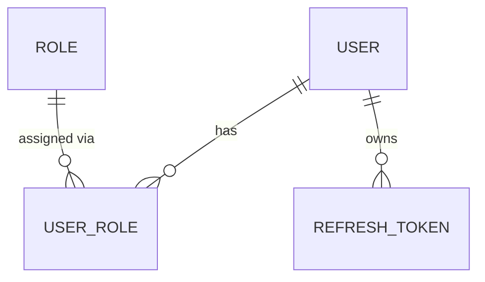
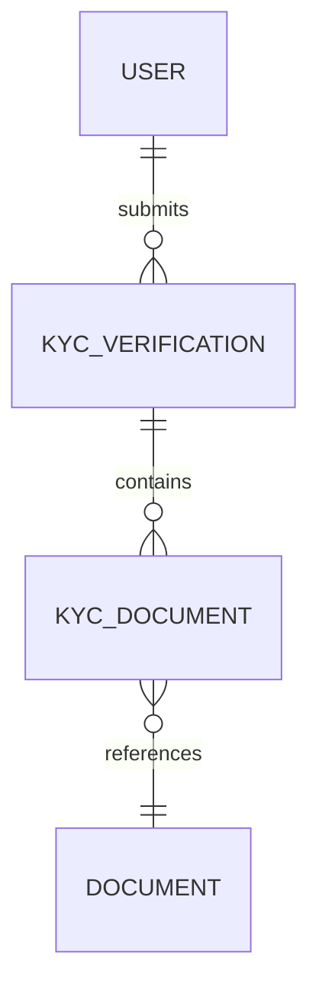
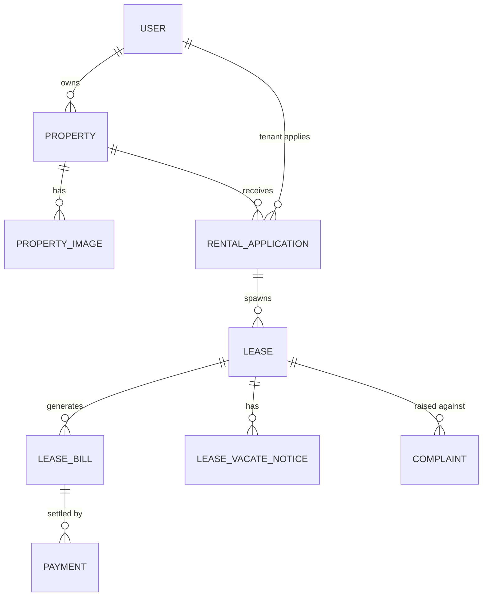
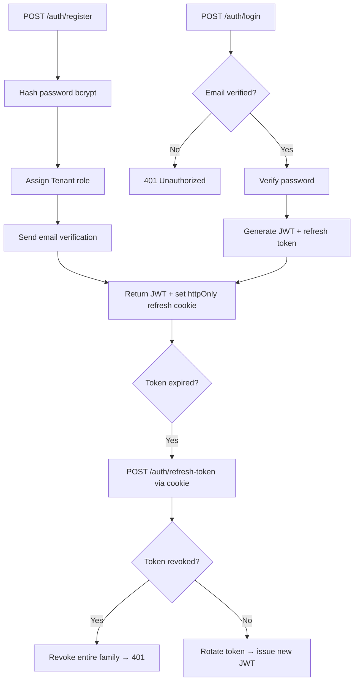
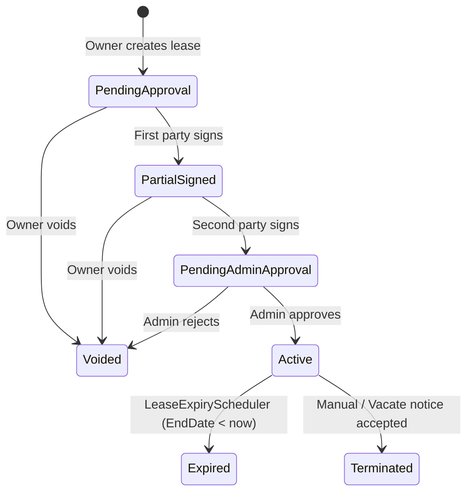

# EstateSync — Backend Engineering Guide

**Stack:** ASP.NET Core 8 · EF Core 8 · PostgreSQL · FluentValidation · QuestPDF · Stripe .NET SDK · SignalR

**Project root:** `backend/EstateSync.Api/`  
**Base URL (local):** `http://localhost:5000`  
**Auth:** JWT Bearer — `Authorization: Bearer <token>` on every protected route  
**Roles:** `Admin`, `Owner`, `Tenant`, `Verifier` (constants in `Common/Roles.cs`)

> When in doubt, follow the **Leases** or **Complaints** domain — they are the most complete reference implementations.

---

## Table of Contents

1. [Architecture — The Non-Negotiable Rules](#1-architecture--the-non-negotiable-rules)
2. [Project Layout](#2-project-layout)
3. [Database — Entities, Schema & EF Core Conventions](#3-database--entities-schema--ef-core-conventions)
4. [Domain Flows (with diagrams)](#4-domain-flows-with-diagrams)
5. [Error Handling](#5-error-handling)
6. [Response Envelopes](#6-response-envelopes)
7. [Validation](#7-validation)
8. [Naming & File Conventions](#8-naming--file-conventions)
9. [Cross-Cutting Services](#9-cross-cutting-services)
10. [Background Jobs](#10-background-jobs)
11. [Enums Reference](#11-enums-reference)
12. [All API Endpoints](#12-all-api-endpoints)
13. [Adding a New Feature — Checklist](#13-adding-a-new-feature--checklist)
14. [Known Architectural Debt](#14-known-architectural-debt)
15. [Local Development & Seeding](#15-local-development--seeding)

---

## 1. Architecture — The Non-Negotiable Rules

### 1.1 Strict Layer Contract

```
HTTP Request
    ↓
Middleware Pipeline  (JWT auth, GlobalExceptionHandler)
    ↓
Controller          — routes, auth attributes, extract userId, call ONE service method, return HTTP result
    ↓
Service             — ALL business logic: state checks, ownership, orchestration, notifications
    ↓
Repository          — ONLY EF Core queries, no business logic
    ↓
AppDbContext        — one instance per HTTP request (scoped), owns SaveChangesAsync
    ↓
PostgreSQL
```

**Controller rules (strict)**
- Extract caller identity with `User.GetUserId()` and pass it to the service.
- Call exactly **one** service method per action.
- Never access a repository directly. Never access `AppDbContext` directly. Never put business logic here.
- The only exception: `SystemController` — dev-only seed/reset that talks to DbContext directly.

**Service rules (strict)**
- Own all business logic: authorization, state-transition guards, orchestration.
- Inject interfaces only — never `AppDbContext`.
- Call `_unitOfWork.SaveChangesAsync()` **once** at the very end of a write operation.
- Throw domain exceptions (`NotFoundException`, `ForbiddenException`, etc.) — never return null silently when something is wrong.

**Repository rules (strict)**
- EF Core queries only — no business rules, no service calls.
- `GetByIdAsync` returns `null` when not found; the service decides what that means.
- Never call `SaveChangesAsync` from a repository — that belongs to the service via `IUnitOfWork`.

### 1.2 Unit of Work

All repositories share the same scoped `AppDbContext` instance. A single `_unitOfWork.SaveChangesAsync()` at the end of a service method commits all tracked changes in one database transaction.

- **Never** call `BeginTransactionAsync` unless a service must call `SaveChanges` more than once.
- The only accepted exception in the codebase: `LeaseService.CreateLeaseAsync()` saves twice (creates lease → generates PDF → updates URL).

### 1.3 SOLID Enforcement

| Principle | Rule |
|---|---|
| SRP | One service per domain. Split if a service exceeds ~150 lines or injects more than 5 repositories. |
| OCP | Add new behaviour with new services/validators, not by extending switch statements. |
| ISP | Never add stub/unimplemented methods to interfaces. |
| DIP | Services depend on `IRepository<T>` and domain interfaces, never on `AppDbContext`. |

---

## 2. Project Layout

```
backend/EstateSync.Api/
├── Common/
│   ├── ApiResponse.cs              # Typed response wrappers (see §6)
│   ├── BaseEntity.cs               # CreatedAt, UpdatedAt, DeletedAt (soft-delete)
│   ├── EmailSettings.cs
│   ├── FileValidation.cs
│   ├── PagedResponse.cs
│   └── Roles.cs                    # Canonical role name constants
│
├── Controllers/                    # Thin HTTP controllers only
│
├── Data/
│   ├── AppDbContext.cs             # EF Core context, global soft-delete query filters
│   ├── AppDbContext.Auditing.cs    # DbContext partial — interceptor that writes AuditLog
│   ├── AuditEntry.cs
│   ├── Configurations/             # IEntityTypeConfiguration<T> per entity
│   └── DbSeeder.cs                 # POST /api/v1/system/reset-and-seed
│
├── DTOs/                           # Request & response shapes, grouped by domain
├── Exceptions/                     # Domain exceptions (all extend AppException)
│
├── Interfaces/
│   ├── Repositories/               # IRepository<T>, domain-specific repo interfaces
│   └── Services/                   # Service interfaces, grouped by domain
│
├── Mappers/                        # Entity ↔ DTO mapping classes (Singletons)
│
├── Migrations/                     # EF Core migration files
│
├── Models/
│   ├── Entities/                   # EF Core entity classes
│   └── Enums/                      # C# enums
│
├── Repositories/                   # EF Core implementations
│   ├── BaseRepository.cs           # Generic CRUD + pagination
│   ├── Interfaces/                 # Domain-specific repo interfaces also live here
│   └── UnitOfWork.cs
│
├── SeedAssets/                     # house.jpeg, house2.jpeg, lease.pdf — copied to uploads/ on seed
│
├── Services/                       # Business logic, grouped by domain sub-folder
│   ├── Background/                 # HostedService background jobs
│   └── ...
│
├── Validators/                     # FluentValidation validators
└── appsettings.json / appsettings.Development.json
```

---

## 3. Database — Entities, Schema & EF Core Conventions

### 3.1 Base conventions

- **Primary keys:** `Guid` on every entity.
- **Soft delete:** Entities that extend `BaseEntity` have `DeletedAt`/`DeletedById`. Global EF query filters (`HasQueryFilter`) automatically exclude soft-deleted rows — you never need to write `WHERE DeletedAt IS NULL` manually.
- **Audit columns:** `CreatedAt`, `CreatedById`, `UpdatedAt`, `UpdatedById` are written automatically by `AppDbContext.Auditing.cs` on every `SaveChangesAsync`. Do not set these manually.
- **`LeaseStatus`** is stored as a **string** in the database (`HasConversion<string>`). Raw SQL, partial indexes, or migrations that touch this column must use string names (`'Active'`, `'Voided'`) not integer values.
- **All `DateTime` values must be UTC.** Set `.Kind = DateTimeKind.Utc` on any client-supplied date before persisting — PostgreSQL rejects unspecified kinds.

### 3.2 Entity groups & relationships

**Identity & Access**



- `User` is the single account table for all four roles. Roles are many-to-many through `UserRole`. A user can hold multiple roles simultaneously (e.g., Tenant who becomes an Owner).
- `User` carries verification flags that gate flows:
  - `IsEmailVerified` — login blocked until true
  - `IsKycVerified` — required to apply for a property or become an Owner
  - `IsOwnerVerified` — Stripe onboarding complete; required to list a property
- `RefreshToken` uses a `TokenFamily` field — reusing a revoked token revokes the entire family (theft detection).

**Verification & Documents**



- `Document` is the shared file record (type, URL, mime, size, uploader, review status). All file-related join tables (`KycDocument`, `PropertyDocument`, `LeaseDocument`) link to it.
- `KycVerification` follows `Draft → Pending → Approved / Rejected`.

**Property, Applications & Leases**



- `Lease` stores the full e-sign trail for both parties: signature text, image URL, timestamp, IP. `SignatureVerificationHash` is `SHA256(leaseId + tenantId + ownerId + tenantSignedAt + ownerSignedAt)`.
- **Partial unique index on `Lease.ApplicationId`**: only one live (not Expired/Terminated/Voided) lease per application. A violation surfaces as Postgres error 23505 and is translated to `ConflictException`.
- `LeaseVacateNotice` — tenant submits an exit date; owner accepts or rejects. Acceptance terminates the lease.
- `LeaseBill` tracks one charge with a `StripeCheckoutSessionId` for Stripe session reuse.

**Payments & Owner Infrastructure**

- `StripeConnectedAccount` — owner's Stripe Connect account (capability flags).
- `StripeCustomerProfile` — tenant's Stripe customer id for session reuse.
- `OwnerSettlement` — owner payout records.

---

## 4. Domain Flows (with diagrams)

### 4.1 Auth & JWT Lifecycle



- JWT claims: `ClaimTypes.NameIdentifier` (userId), `"name"` (fullName), `ClaimTypes.Email`, `ClaimTypes.Role` (per role), `jti`.
- Access token expiry: short-lived (see `appsettings.json`). Refresh token stored in DB with family tracking.

### 4.2 KYC Flow

```
POST /api/v1/kyc/draft       → KycService.CreateDraftAsync()     status = Draft
PUT  /api/v1/kyc/{id}/documents → upload AadhaarFront, AadhaarBack, PanCard, AddressProof
POST /api/v1/kyc/{id}/submit → status: Draft → Pending
PUT  /api/v1/admin/kyc-requests/{id}/review [Admin/Verifier]
    → status: Pending → Approved / Rejected
    → If Approved: User.IsKycVerified = true
```

### 4.3 Owner Onboarding

```
POST /api/v1/users/me/become-owner  → User.IsKycVerified must be true → assign Owner role
POST /api/v1/payments/owner-onboard → create Stripe Connect account → return onboarding URL
                                     (Stripe webhook sets IsOwnerVerified = true on completion)
```

### 4.4 Property Listing

```mermaid
flowchart LR
    A[POST /properties] --> B((Draft))
    B --> C[Upload images / amenities / documents]
    C --> D[PUT /properties/{id}/submit]
    D --> E((PendingApproval))
    E --> F{Admin reviews}
    F -->|Approve| G((Active))
    F -->|Reject| H((Rejected))
```

### 4.5 Rental Application

```
POST /api/v1/RentalApplications/properties/{propertyId}  [Tenant — IsKycVerified required]
  → status = Pending

PUT /api/v1/RentalApplications/{id}/review  [Owner]
  → Pending → Approved (one per property) or Rejected
```

### 4.6 Lease Lifecycle (Full E-Sign Flow)



**Detailed steps:**

1. `POST /api/v1/leases` — Owner creates lease from Approved application. PDF generated via `ILeaseDocumentService`. Status = `PendingApproval`.
2. `PUT /api/v1/leases/{id}/sign` — Either party signs. Body: `{ signatureText, signatureImageBase64 }`. Signature image (base64 PNG) decoded and saved to `uploads/leases/{id}/{party}-sig.png`.
3. When both have signed → status = `PendingAdminApproval`. SHA-256 hash computed. Signed PDF with embedded signatures generated.
4. Admin notified via `LeasePendingAdminApproval` notification.
5. `PUT /api/v1/admin/leases/{id}/approval` — Admin approves → status = `Active`, property = `Leased`, bills generated, other applications rejected.
6. Admin rejects → status = `Voided`.

**Vacate Notice sub-flow (within Active lease):**

```
POST /api/v1/leases/{id}/vacate-notice  [Tenant]  → LeaseVacateNotice status = Pending
PUT  /api/v1/leases/{id}/vacate-notice/accept  [Owner] → lease status = Terminated
PUT  /api/v1/leases/{id}/vacate-notice/reject  [Owner] → notice status = Rejected
```

### 4.7 Payment Flow

```
GET  /api/v1/payments/tenant/bills
POST /api/v1/payments/checkout/{leaseBillId}  → Stripe Checkout session → redirect tenant
POST /api/v1/payments/webhook               → Stripe validates → LeaseBill.Status = Paid
```

### 4.8 Complaint Flow

```
POST /api/v1/complaints          [Tenant — active lease required]  → status = Open
POST /api/v1/complaints/{id}/images
PUT  /api/v1/complaints/{id}/status
  → Open → InProgress → Resolved → Closed
```

---

## 5. Error Handling

All domain exceptions extend `AppException` (`Exceptions/AppException.cs`) and carry an `HttpStatusCode`. The `GlobalExceptionHandler` middleware catches them all and returns RFC 7807 `ProblemDetails` JSON — never expose raw stack traces.

| Exception | HTTP Status | When to throw |
|---|---|---|
| `NotFoundException(name, key)` | 404 | Entity not found by ID |
| `BadRequestException(msg)` | 400 | Invalid input that passed validation but fails business rules |
| `ForbiddenException(msg)` | 403 | Caller owns the token but not the resource |
| `ConflictException(msg)` | 409 | Duplicate or state conflict (e.g. duplicate active lease) |
| `UnauthorizedException(msg)` | 401 | Caller identity is invalid |

**Rules:**
- Never swallow an exception silently. If you catch one, either translate it (`ConflictException` for Postgres 23505) or rethrow.
- Never return `null` from a service when an entity is missing — throw `NotFoundException`.
- Never `return BadRequest(ex.Message)` from a controller — throw from the service instead.

---

## 6. Response Envelopes

Every endpoint **must** wrap its result. The Angular client unwraps the `data` field on everything — an unwrapped response produces a silently empty list in the UI.

```csharp
// Single object
return Ok(new ApiResponse<LeaseResponse> { Success = true, Data = dto });

// Paginated list
return Ok(new PagedResponse<LeaseResponse> { Success = true, Data = list, Page = page, Limit = limit, Total = total });
```

`ApiResponse<T>` and `PagedResponse<T>` live in `Common/`.

---

## 7. Validation

Every request DTO gets a **FluentValidation validator** (`Validators/DtоValidator.cs`). Validators are registered automatically by the assembly scanner in `Program.cs`.

**Rule of thumb:** validators check shape and format (required, length, range, regex). Business rules (state, ownership) belong in the service — don't duplicate them in validators.

```csharp
// Example shape
public class CreateLeaseRequestValidator : AbstractValidator<CreateLeaseRequest>
{
    public CreateLeaseRequestValidator()
    {
        RuleFor(x => x.MonthlyRent).GreaterThan(0);
        RuleFor(x => x.StartDate).LessThan(x => x.EndDate);
        RuleFor(x => x.SecurityDeposit).GreaterThanOrEqualTo(0);
    }
}
```

---

## 8. Naming & File Conventions

| Artefact | Pattern | Location |
|---|---|---|
| Controller | `{Feature}Controller.cs` | `Controllers/` |
| Route | `api/v1/[controller]` (PascalCase token!) | — |
| Service interface | `I{Feature}Service.cs` | `Interfaces/Services/{Feature}/` |
| Service implementation | `{Feature}Service.cs` | `Services/{Feature}/` |
| Repository interface | `I{Feature}Repository.cs` | `Interfaces/Repositories/` or `Repositories/Interfaces/` |
| Repository implementation | `{Feature}Repository.cs` | `Repositories/` |
| Request DTO | `{Action}{Feature}Request.cs` | `DTOs/{Feature}/` |
| Response DTO | `{Feature}Response.cs` | `DTOs/{Feature}/` |
| Validator | `{Dto}Validator.cs` | `Validators/` |
| Mapper | `{Feature}Mapper.cs` | `Mappers/` (Singleton) |
| Entity config | `{Entity}Configuration.cs` | `Data/Configurations/` |

**Critical gotcha:** The `[controller]` route token preserves PascalCase. `RentalApplicationsController` → `/api/v1/RentalApplications` (not kebab-case). The frontend must use this exact casing.

---

## 9. Cross-Cutting Services

### File Storage — `IFileStorageService`

Always use this interface. Never access the filesystem directly from a service. The lease PDF generator (`LeaseDocumentService`) is the only accepted exception — it resolves physical paths via `IWebHostEnvironment`.

Uploaded files are served at `http://localhost:5000/uploads/...` via static file middleware.

### Notifications — `INotificationSender`

Every user-visible status change must send a notification. The sender fans out to:
1. A `Notification` DB row
2. A SignalR push to the affected user's connection group
3. An email via `IEmailQueue` (for important notification types)

When adding a new `NotificationType`, decide whether it belongs in the email-worthy list.

### Email — `IEmailQueue`

Never send SMTP inline from a service. Enqueue a message on `IEmailQueue`; the background `EmailDispatcher` delivers it with retries. A mail failure must **never** fail a business operation.

### Audit Log

Writes are automatic — `AppDbContext.Auditing.cs` intercepts every `SaveChangesAsync` and records changes into `AuditLogs`. Nothing to do; just don't work around the DbContext.

---

## 10. Background Jobs

Both run as `BackgroundService` (`IHostedService`) and resolve scoped services via `IServiceScopeFactory`.

| Service | Schedule | What it does |
|---|---|---|
| `PropertyStatusUpdateScheduler` | Every 24h, starts immediately | Active leases ending within 3 months → property `Leased → AvailableSoon`. Sends `LeaseExpiring` notification (once, on first status change). |
| `LeaseExpiryScheduler` | Every 24h, offset 1h from above | Active leases where `EndDate < now` → status `Expired`, property `AvailableSoon/Leased → Active`. Sends `LeaseExpired` notification. |

The 1-hour offset prevents both jobs from hammering the DB simultaneously on startup.

---

## 11. Enums Reference

**Never renumber or reorder existing values. Append only.** EF Core stores many enums as integers; the frontend mirrors these values directly.

```csharp
// PropertyStatus
Draft = 0, PendingApproval = 1, Active = 2, Rejected = 3, Rented = 4, Leased = 5, AvailableSoon = 6

// LeaseStatus (stored as STRING in DB)
PendingApproval = 0, Active = 1, Expired = 2, Terminated = 3,
PendingAdminApproval = 4, PartialSigned = 5, Voided = 6

// ApplicationStatus
Pending = 0, Approved = 1, Rejected = 2, Withdrawn = 3

// ApprovalStatus (KYC)
Draft = 0, Pending = 1, Approved = 2, Rejected = 3

// PaymentFrequency
Monthly = 0, Quarterly = 1, HalfYearly = 2, Yearly = 3

// PaymentStatus (LeaseBill)
Pending = 0, Paid = 1, Failed = 2

// LeaseBillType
Rent = 0, Deposit = 1, Penalty = 2, Maintenance = 3, Other = 4

// ComplaintType / ComplaintStatus / ComplaintPriority — see Models/Enums/

// DocumentType
AadhaarFront, AadhaarBack, PanCard, AddressProof,
PropertyDeed, PropertyTaxReceipt, OwnershipCertificate,
SalarySlip, BankStatement, EmploymentLetter, IncomeTaxReturn

// NotificationType — see Models/Enums/NotificationType.cs for the full list
// VacateNoticeStatus: Pending, Accepted, Rejected
```

---

## 12. All API Endpoints

### Auth — `/api/v1/auth`
| Method | Route | Auth | Notes |
|---|---|---|---|
| POST | `/register` | — | Default role: Tenant |
| POST | `/login` | — | Returns JWT + sets httpOnly cookie |
| POST | `/refresh-token` | Cookie | Rotates both tokens |
| POST | `/verify-email` | — | Token from email |
| POST | `/resend-verification` | — | |

### Properties — `/api/v1/properties`
| Method | Route | Auth | Notes |
|---|---|---|---|
| GET | `/` | — | ?state ?propertyType ?bedrooms ?minRent ?maxRent |
| GET | `/{id}` | — | Public detail |
| GET | `/me` | Owner | |
| POST | `/` | Owner | Draft status |
| PUT | `/{id}` | Owner | |
| DELETE | `/{id}` | Owner, Admin | Soft delete |
| PUT | `/{id}/submit` | Owner | Draft → PendingApproval |
| POST | `/{id}/images` | Owner | Multipart |
| DELETE | `/{id}/images/{imageId}` | Owner | |
| POST | `/{id}/amenities` | Owner | |
| PUT | `/{id}/amenities` | Owner | Replace list |
| DELETE | `/{id}/amenities` | Owner | |
| POST | `/{id}/documents` | Owner | |
| GET | `/{id}/documents` | Owner, Admin | |

### KYC — `/api/v1/kyc`
| Method | Route | Auth | Notes |
|---|---|---|---|
| POST | `/draft` | Auth | |
| PUT | `/{kycId}/documents` | Auth | ?documentType query param |
| POST | `/{kycId}/submit` | Auth | |
| GET | `/me` | Auth | |

### Users — `/api/v1/users`
| Method | Route | Auth | Notes |
|---|---|---|---|
| POST | `/me/become-owner` | Auth | Requires IsKycVerified |
| GET | `/me/profile` | Auth | KYC/owner verification state |

### Rental Applications — `/api/v1/RentalApplications` (PascalCase!)
| Method | Route | Auth | Notes |
|---|---|---|---|
| POST | `/properties/{propertyId}` | Tenant | |
| PUT | `/{id}/review` | Owner | Approve/Reject |
| GET | `/owner` | Owner | |
| GET | `/properties/{propertyId}` | Owner | |
| GET | `/tenant` | Tenant | |
| GET | `/{id}` | Tenant, Owner, Admin | |

### Leases — `/api/v1/leases`
| Method | Route | Auth | Notes |
|---|---|---|---|
| POST | `/` | Owner | |
| PUT | `/{id}` | Owner | PendingApproval only |
| PUT | `/{id}/sign` | Owner, Tenant | Body: signatureText + signatureImageBase64 |
| POST | `/{id}/void` | Owner | |
| POST | `/{id}/terminate` | Owner, Admin | Active lease |
| GET | `/{id}` | Owner, Tenant, Admin | |
| GET | `/tenant` | Tenant | |
| GET | `/owner` | Owner | |
| GET | `/` | Admin | All |
| POST | `/{id}/request-renewal` | Tenant | |
| POST | `/{id}/reject-renewal` | Owner | |
| GET | `/{id}/bills` | Owner, Tenant, Admin | |
| GET | `/{id}/payments` | Owner, Tenant, Admin | |
| POST | `/{id}/vacate-notice` | Tenant | Submit vacate notice |
| GET | `/{id}/vacate-notice` | Owner, Tenant, Admin | Get current notice |
| PUT | `/{id}/vacate-notice/accept` | Owner | |
| PUT | `/{id}/vacate-notice/reject` | Owner | Body: { reason } |

### Payments — `/api/v1/payments`
| Method | Route | Auth | Notes |
|---|---|---|---|
| POST | `/owner-onboard` | Owner | Returns Stripe URL |
| POST | `/checkout/{leaseBillId}` | Tenant | Returns Stripe URL |
| GET | `/tenant/bills` | Tenant | |
| POST | `/webhook` | — | Stripe webhook, validates signature |

### Complaints — `/api/v1/complaints`
| Method | Route | Auth | Notes |
|---|---|---|---|
| POST | `/` | Tenant | |
| PUT | `/{id}/status` | Auth | |
| GET | `/{id}` | Auth | |
| GET | `/tenant` | Tenant | |
| GET | `/owner` | Owner | |
| POST | `/{id}/images` | Tenant | |

### Admin — `/api/v1/admin`
| Method | Route | Auth | Notes |
|---|---|---|---|
| GET | `/kyc-requests` | Admin, Verifier | ?status |
| PUT | `/kyc-requests/{id}/review` | Admin, Verifier | |
| GET | `/properties/pending-approval` | Admin | |
| PUT | `/properties/{id}/approval` | Admin | |
| PUT | `/leases/{id}/approval` | Admin | |
| POST | `/staff` | Admin | Create Verifier |
| PUT | `/staff/{userId}/deactivate` | Admin | |

### Audit Logs — `/api/v1/audit-logs`
| Method | Route | Auth | Notes |
|---|---|---|---|
| GET | `/` | Admin | ?entityType ?entityId ?action |

### System (Dev Only) — `/api/v1/system`
| Method | Route | Auth | Notes |
|---|---|---|---|
| POST | `/reset-and-seed` | — | Wipe DB + seed |
| POST | `/seed-test-bill` | — | Create test LeaseBill |

---

## 13. Adding a New Feature — Checklist

```
Entity
  [ ] Create entity class in Models/Entities/ extending BaseEntity (if soft-deletable)
  [ ] Create IEntityTypeConfiguration<T> in Data/Configurations/
  [ ] Register DbSet in AppDbContext.cs
  [ ] Add HasQueryFilter if soft-deletable
  [ ] dotnet ef migrations add <Name>

Repository
  [ ] Interface in Interfaces/Repositories/ extending IRepository<T>
  [ ] Implementation in Repositories/ extending BaseRepository<T>
  [ ] Register in UnitOfWork.cs

DTOs
  [ ] Request DTO in DTOs/{Feature}/
  [ ] Response DTO in DTOs/{Feature}/
  [ ] FluentValidation validator in Validators/

Service
  [ ] Interface in Interfaces/Services/{Feature}/
  [ ] Implementation in Services/{Feature}/
  [ ] Inject IUnitOfWork, required repositories, INotificationSender
  [ ] Validate ownership/authorization before acting
  [ ] Single SaveChangesAsync at the end of each write method
  [ ] Throw NotFoundException / ForbiddenException / BadRequestException as appropriate
  [ ] Send notification on every status transition

Controller
  [ ] One method per route — extract userId, call service, return ApiResponse<T>
  [ ] [Authorize(Roles = Roles.X)] attribute
  [ ] Route follows api/v1/[controller] convention

Mapper
  [ ] Static or DI mapper in Mappers/
  [ ] Register as Singleton in Program.cs

Tests (backend/EstateSync.Tests)
  [ ] Service unit tests mocking repositories
```

---

## 14. Known Architectural Debt

| Issue | Location | Rule |
|---|---|---|
| `SystemController` accesses `DbContext` directly | `Controllers/SystemController.cs` | Acceptable **only** for seed/reset. No other controller may do this. |
| `PropertyService` injects 8+ repositories | `Services/Properties/PropertyService.cs` | Do not add more. Future: split into `PropertyService` + `PropertySearchService`. |
| `LeaseService.CreateLeaseAsync()` calls `SaveChangesAsync` twice | `Services/Leases/LeaseService.cs` | Known exception — first save creates lease, second updates PDF URL. Do not generalise this pattern. |

---

## 15. Local Development & Seeding

```bash
# Start backend
dotnet run --project backend/EstateSync.Api
# → http://localhost:5000

# Apply pending migrations
dotnet ef database update --project backend/EstateSync.Api

# Create a new migration
dotnet ef migrations add <MigrationName> --project backend/EstateSync.Api

# Run tests
dotnet test
```

### Seed test users (after POST /api/v1/system/reset-and-seed)

| Role | Email | Password |
|---|---|---|
| Admin | admin@estatesync.com | Password123! |
| Owner | owner@estatesync.com | Password123! |
| Tenant | tenant@estatesync.com | Password123! |

`SeedAssets/` (tracked in git) contains `house.jpeg`, `house2.jpeg`, and `lease.pdf`. The seeder copies them to `uploads/properties/seed/` on startup — do not delete this folder.

### Environment variables / appsettings

Key settings in `appsettings.Development.json`:
- `ConnectionStrings:DefaultConnection` — PostgreSQL connection string
- `Jwt:Secret` — signing key
- `Stripe:SecretKey`, `Stripe:WebhookSecret`
- `EmailSettings:*` — SMTP config

Never commit real secrets. Use `dotnet user-secrets` or environment variables for local overrides.
