# EstateSync — Database Schema & User Flows

This document explains the database schema and every major user flow, with diagrams. Diagrams are written in Mermaid — GitHub and the VS Code markdown preview render them automatically.

---

# Part 1 — Database Schema

## Entity overview

All entities live in `backend/EstateSync.Api/Models/Entities/`, configured in `Data/Configurations/`. Primary keys are Guids. Most tables also carry audit columns (CreatedAt/CreatedById, UpdatedAt/UpdatedById, soft-delete DeletedAt/DeletedById) written automatically by the DbContext interceptor, which also records every change into AuditLog.

| Group | Tables |
|---|---|
| Identity & access | User, Role, UserRole, RefreshToken |
| Verification | KycVerification, KycDocument, TenantFinancialProfile, TenantFinancialDocument, Document |
| Owner & payments infra | OwnerProfile, StripeConnectedAccount, StripeCustomerProfile, OwnerSettlement |
| Property | Property, PropertyImage, PropertyDocument, SavedProperty |
| Renting | RentalApplication, Lease, LeaseDocument, RentIncreaseProposal |
| Money | LeaseBill, Payment |
| Support & system | Complaint, ComplaintImage, Notification, AuditLog |

## Identity, roles and verification

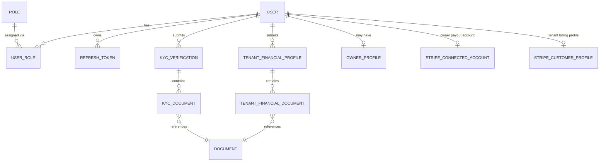

Key points:

- **User** is the single account table for all four roles (Admin, Owner, Tenant, Verifier). Roles are many-to-many through **UserRole**. A user can hold several roles — a tenant who becomes an owner keeps both.
- User carries the verification flags that gate the flows: `IsEmailVerified` (login is blocked until true), `IsKycVerified` (needed to apply for property or become owner), `IsOwnerVerified` (Stripe onboarding complete, needed to list property), `IsFinanciallyVerified` + `VerifiedMonthlyIncome` (needed for income-restricted properties).
- **RefreshToken** stores rotating refresh tokens with a `TokenFamily` so a stolen/reused token revokes the whole family.
- **Document** is the shared file table (type, URL, mime, size, uploader, review status). KYC, financial profiles, properties and leases all link to it through small join tables (KycDocument, TenantFinancialDocument, PropertyDocument, LeaseDocument) rather than duplicating file columns.
- **KycVerification** and **TenantFinancialProfile** both follow the same review pattern: status Draft → Pending → Approved/Rejected, with ReviewedBy, ReviewRemarks, ReviewedAt.

## Property, applications and leases

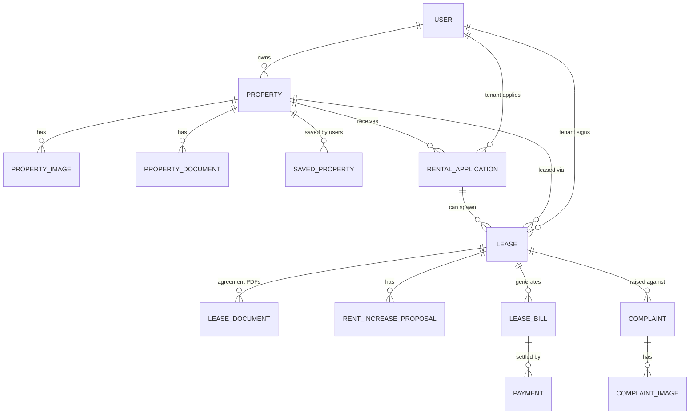

Key points:

- **Property** belongs to one owner and carries address, rent, deposit, bedrooms/bathrooms, amenities (string list), the approval trail (ApproveBy, ApproveRemarks) and `RequiresVerifiedIncome`.
- **RentalApplication** links a tenant to a property with a message, expected move-in date and duration. An application *can* have many lease rows historically, but a **partial unique index on Lease.ApplicationId** guarantees only one live lease (status not Expired/Terminated/Voided) exists per application at a time.
- **Lease** is the richest table: term dates, rent, deposit, payment frequency, notice period, penalty percentage, the full e-sign trail for both parties (signature text, image URL, timestamp, IP), a SHA-256 `SignatureVerificationHash`, admin approval trail, cancellation trail, `IsRenewalRequested` and `IsDepositForfeited`. Note: `LeaseStatus` is stored as a **string** in the database.
- **LeaseBill** is one charge (Deposit, Rent, Penalty, Maintenance) with amount, pending amount, due date and the active Stripe session id. **Payment** records each gateway transaction against a bill, including platform fee and raw gateway response.
- **Complaint** hangs off a lease (optionally a specific bill) with type, priority, status and images.

## Money and platform tables

- **StripeConnectedAccount** — the owner's Stripe Connect account and its capability flags (charges enabled, payouts enabled, details submitted). An owner may list property only after onboarding completes.
- **StripeCustomerProfile** — the tenant's Stripe customer id, created lazily at first checkout.
- **OwnerSettlement** — a record of each Stripe payout to an owner.
- **Notification** — per-user in-app notification (type, title, message, entity pointer, read flag). Also the trigger point for emails: email-worthy types get queued to SMTP.
- **AuditLog** — automatic before/after JSON snapshot of every entity change, written by the DbContext interceptor.

---

# Part 2 — User Flows

## Flow 0: The big picture

The platform is a pipeline of gates. Each gate must be passed before the next step unlocks:

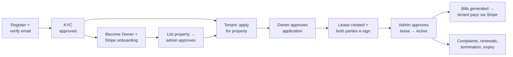

## Flow 1: Registration, email verification and login

New accounts get the Tenant role by default and cannot sign in until the email is verified.

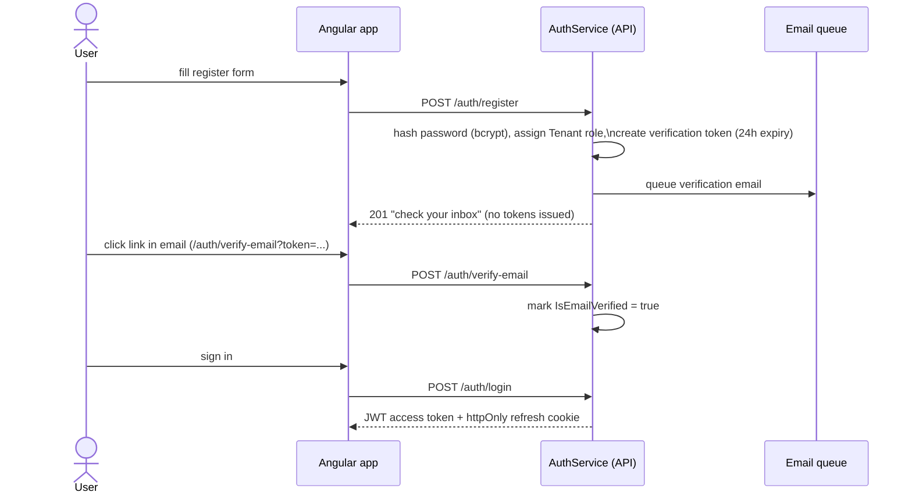

Explained:

- Registration does **not** log the user in. It only sends a verification email; login before verification is rejected with a "please verify" error, and the login page offers a resend link.
- On login the API returns a short-lived JWT access token in the body and sets the refresh token as an httpOnly cookie. The Angular app keeps the access token in memory only; on page reload it silently calls refresh-token (guided by the `es_has_session` localStorage hint) to restore the session. Refresh tokens rotate on every use.

## Flow 2: KYC verification (gate for everything)

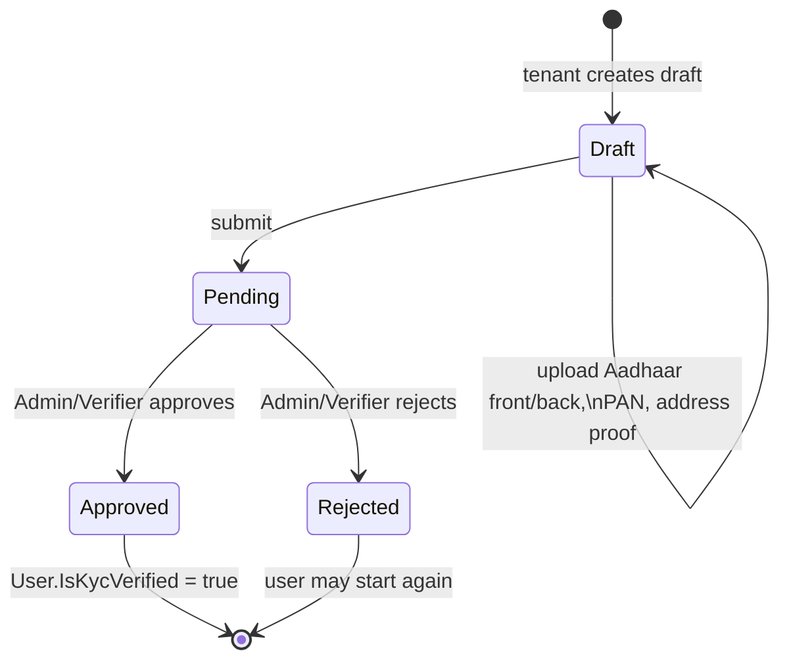

Explained: the user creates a KYC draft, uploads the four document types, then submits. An Admin or Verifier reviews it in the staff portal. Approval flips `User.IsKycVerified`, which unlocks both applying for properties (tenant side) and becoming an owner. The frontend drives this with a four-step wizard where steps can never be skipped forward.

## Flow 3: Tenant financial profile (optional gate)

Same state machine as KYC (Draft → Pending → Approved/Rejected), but with employment details and income documents (salary slips, bank statements). Approval sets `IsFinanciallyVerified` and stores `VerifiedMonthlyIncome`. It is only required to apply for properties flagged `RequiresVerifiedIncome`.

## Flow 4: Becoming an owner and Stripe onboarding

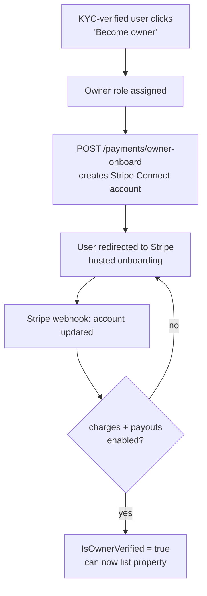

Explained: becoming an owner requires KYC first (ForbiddenException otherwise). Listing property additionally requires completed Stripe onboarding, because rent payments flow to the owner's connected account.

## Flow 5: Property listing and approval

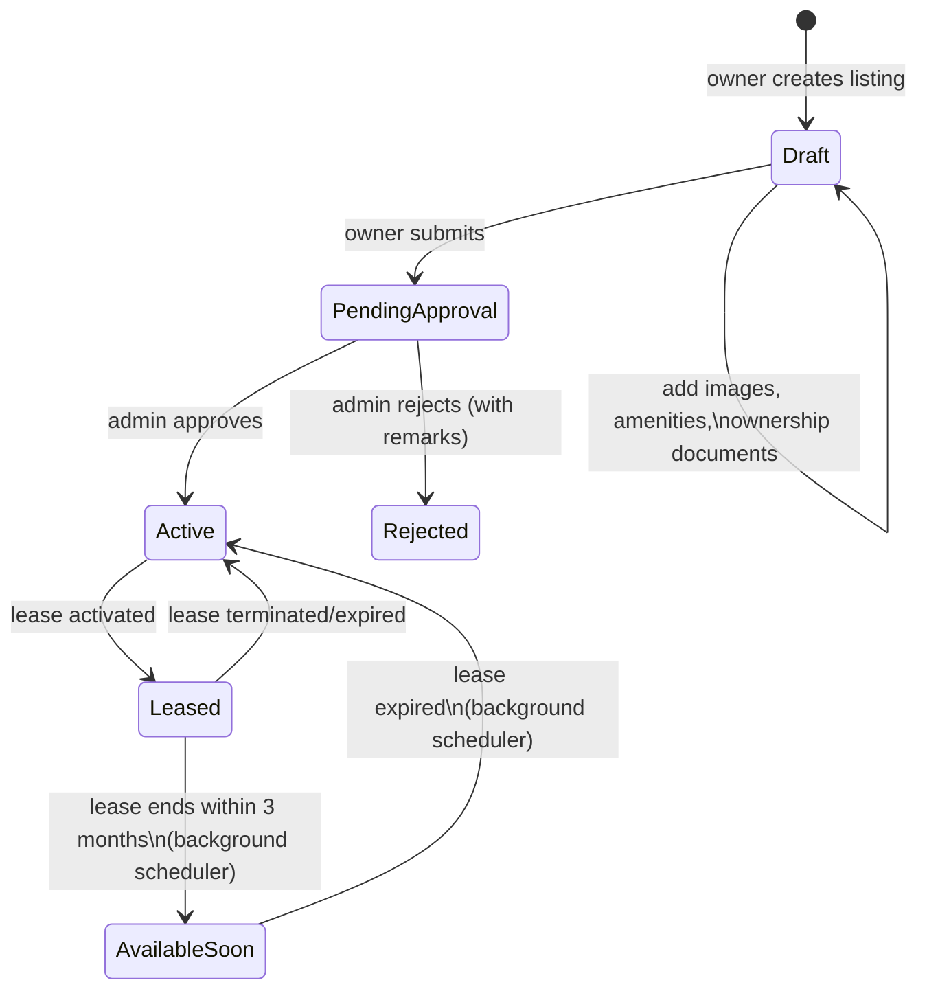

Explained: a listing starts as Draft where the owner attaches photos, amenities and ownership documents. Submitting moves it to PendingApproval; only an admin can make it Active (publicly searchable). Once a lease on it activates, the property becomes Leased. Two background schedulers manage the tail end: one flips Leased → AvailableSoon three months before the lease ends (and notifies both parties), the other flips it back to Active when the lease actually expires.

## Flow 6: Rental application

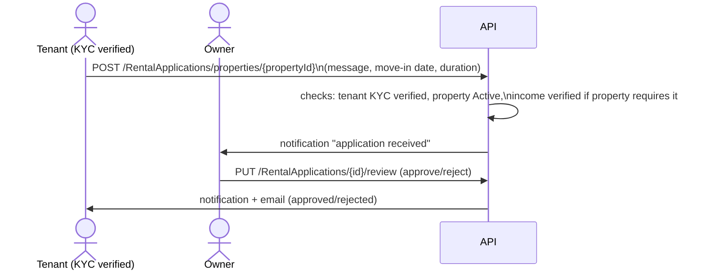

Explained: only one application per property can be Approved. When a lease is later admin-approved, all other pending/approved applications for that property are automatically rejected.

## Flow 7: Lease lifecycle (the core of the platform)

### State machine

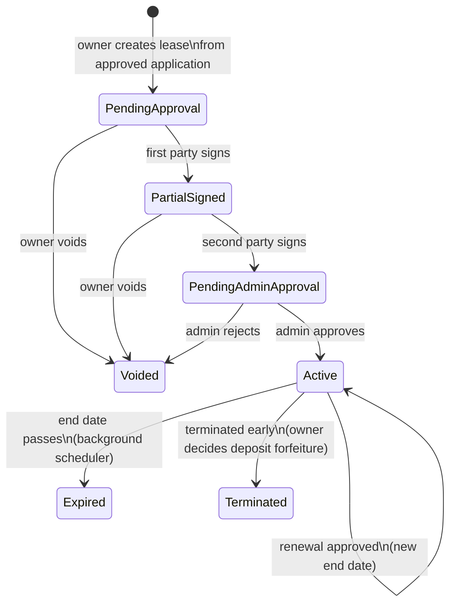

### End-to-end sequence

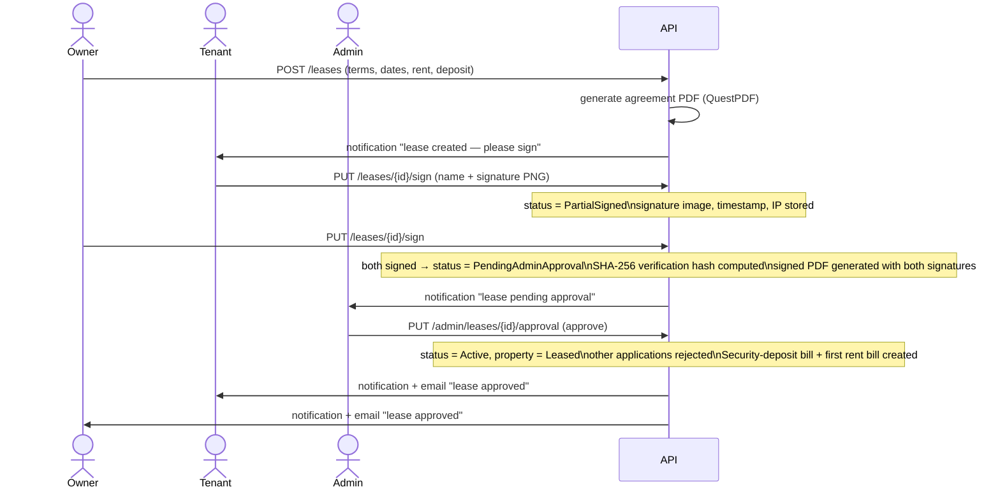

Explained, step by step:

1. **Creation** — the owner creates a lease from an approved application. The tenant must be KYC verified. The system generates the agreement PDF immediately. The partial unique index guarantees a second live lease can't be created for the same application (a race returns a conflict error).
2. **Editing** — the owner can update terms only while the status is PendingApproval (before anyone signed); the PDF regenerates.
3. **Signing** — either party signs first. The frontend uses a signature pad canvas; the PNG, typed name, timestamp and IP address are stored per party. After the second signature the system computes a SHA-256 hash over lease id, both party ids and both timestamps, embeds both signatures and the hash into a final signed PDF, and notifies all admins.
4. **Admin decision** — approval activates the lease, marks the property Leased, rejects competing applications, and generates the first two bills (security deposit and first rent). Rejection voids the lease.
5. **Renewal** — the tenant requests renewal on an active lease; the owner either approves (choosing the new end date, which must be later than the current one) or declines. Approval also restores the property from AvailableSoon back to Leased.
6. **Termination** — an active lease can be terminated manually; the owner decides whether the security deposit is forfeited (`IsDepositForfeited`), and both parties are notified accordingly.
7. **Expiry** — a daily background scheduler expires leases past their end date and frees the property.

## Flow 8: Payments (Stripe)

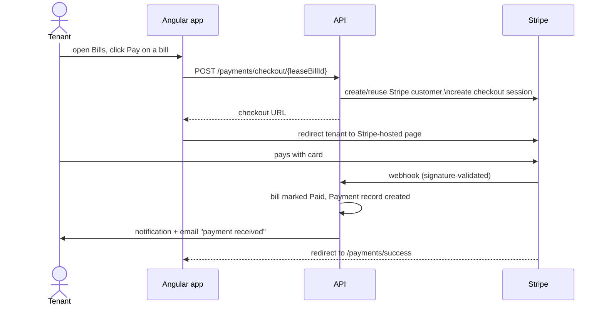

Explained: the API never touches card data — Stripe hosts the payment page. The source of truth for payment success is the **webhook**, not the redirect: the success page is cosmetic, while the webhook (validated by Stripe's signature) updates the bill and writes the Payment row. Owner payouts arrive via Stripe Connect and are recorded as OwnerSettlement rows. Rent-due reminders and penalty bills are produced by background schedulers.

## Flow 9: Complaints

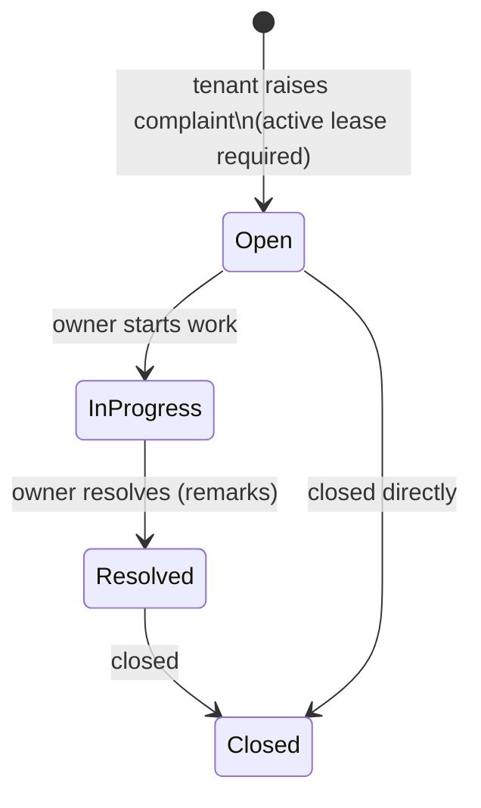

Explained: a tenant with an active lease raises a complaint with a type (maintenance, billing, noise, …), a priority, a description, and optional photos. The property owner sees complaints for their properties, moves them through the statuses and can attach resolution remarks. Both dashboards support filtering, and raising a complaint notifies (and emails) the owner.

## Flow 10: Background jobs (no user involved)

All are hosted BackgroundServices in `Services/Background/` (plus the email dispatcher in `Services/Email/`):

- **PropertyStatusUpdateScheduler** — leases ending within 3 months: property Leased → AvailableSoon, "lease expiring" notifications (fires once per lease).
- **LeaseExpiryScheduler** — leases past end date: lease → Expired, property → Active, "lease expired" notifications. Starts 1 hour after the other scheduler to avoid lock contention.
- **LeaseBillScheduler** — generates the recurring rent bills for active leases according to their payment frequency, with rent-due notifications.
- **PenaltyScheduler** — creates penalty bills for overdue rent, using the lease's penalty percentage.
- **RefreshTokenCleanupScheduler** — prunes expired and long-revoked refresh tokens so the table doesn't grow unbounded (keeps recently revoked ones for the rotation grace window).
- **EmailDispatcher** — continuously drains the in-memory email queue and delivers over SMTP with retries; mail failures never affect business operations.
