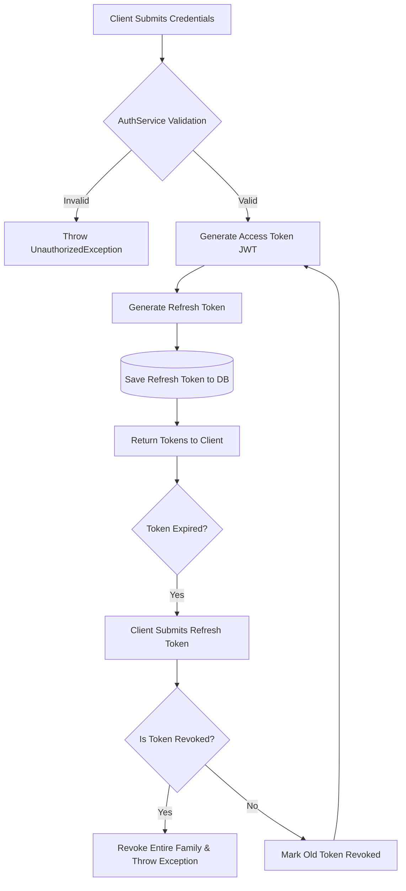
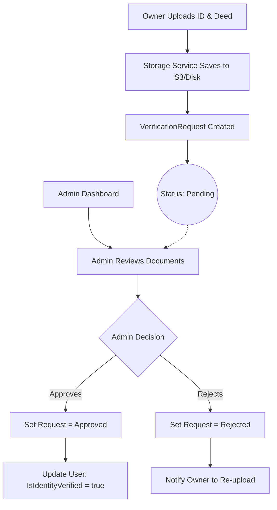
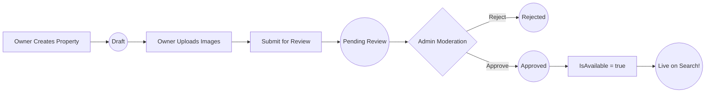
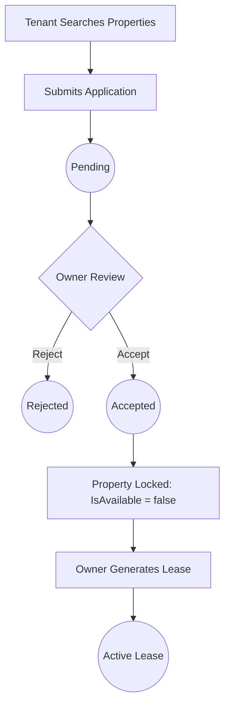
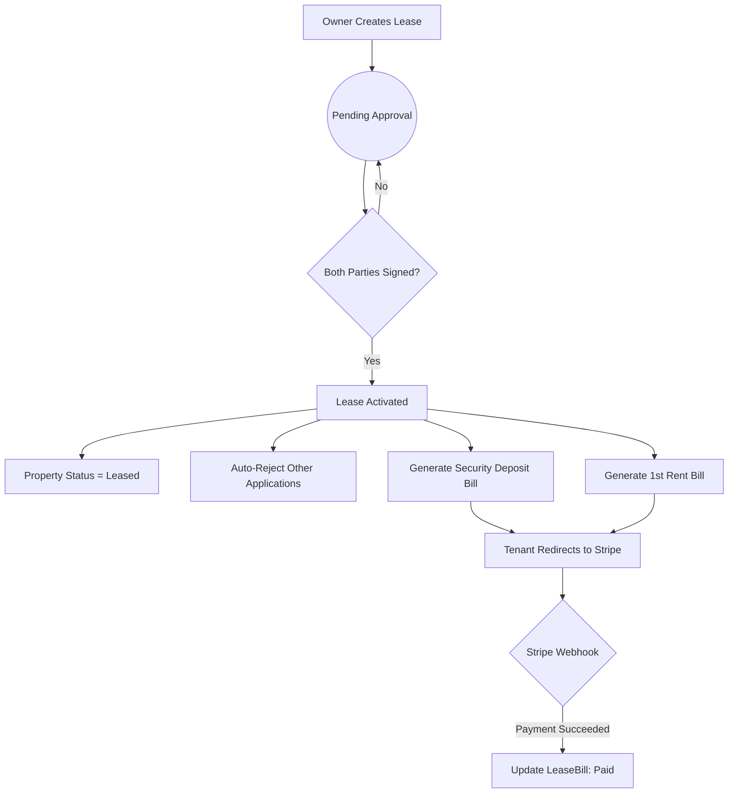
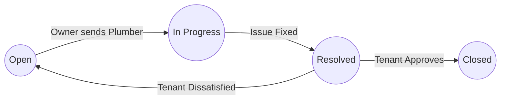
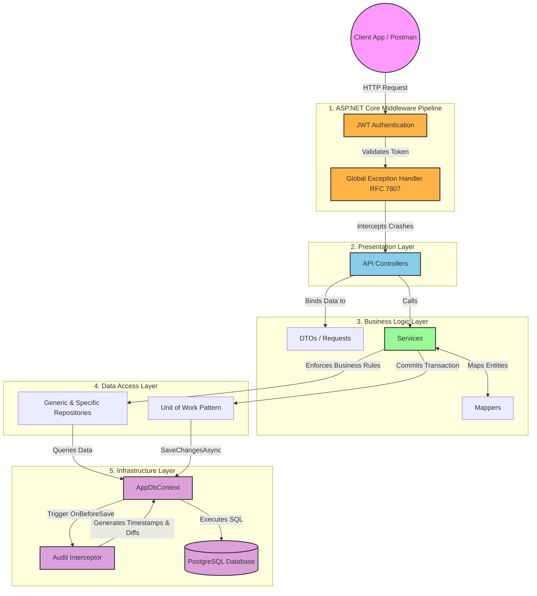

# EstateSync Backend Architecture & Workflows

Welcome to the architectural documentation for **EstateSync Web API**. This document outlines the core domain modules using visual flowcharts, culminating in a detailed, high-level map of our strictly layered, enterprise-grade application architecture.

---

## 1. Authentication & JWT Lifecycle

The Authentication flow ensures secure, stateless access using JWT and Refresh Tokens.

---

## 2. Identity & Owner Verification Flow

Security is paramount. Owners cannot list properties without administrative verification of their documentation.

---

## 3. Property Publishing Flow

Properties go through a moderation pipeline to ensure quality and prevent spam.

---

## 4. Rental Application & Leasing Flow

The core negotiation flow connecting Tenants to Owners.

---

## 5. Lease Agreement & Financial Flow

Once an application is approved, the legal binding and financial tracking begin. This module requires dual-signatures (Owner and Tenant) before automatically generating the first cycle of Stripe-payable bills.

### **The Lease Flow:**
1. **Lease Generation**: The Owner creates a `Lease` setting the monthly rent, security deposit, and start/end dates. The Lease status becomes `PendingApproval`.
2. **Dual Signature**: The Tenant and the Owner both hit the `SignLease` endpoint to digitally sign the agreement and upload the signed PDF.
3. **Lease Activation**: Once *both* parties have signed, the system automatically sets the Lease to `Active` and changes the Property status to `Leased`.
4. **Auto-Rejection**: The system automatically rejects all other pending applications for this property.
5. **Bill Generation**: The system automatically generates `LeaseBill` entries (one for the Security Deposit, and one for the first Rent cycle based on frequency).
6. **Stripe Checkout**: The Tenant clicks "Pay" on the bill. The `PaymentService` generates a secure Stripe Checkout URL.
7. **Webhook Fulfillment**: Stripe sends a Webhook back to EstateSync upon successful payment, which updates the `LeaseBill` status to `Paid`.

---

## 6. Complaints & Maintenance Ticketing

A simple state machine allowing tenants and owners to manage property issues.

---

# 🏗️ High-Level System Architecture

EstateSync is built on a clean, strictly-layered **N-Tier Architecture**. The flowchart below illustrates the exact path an HTTP Request takes from the moment it hits the server until it is safely written to PostgreSQL.

### Key Architectural Highlights:
1. **Middlewares**: `GlobalExceptionHandler` intercepts all crashes and returns RFC 7807 standard JSON `ProblemDetails`, hiding stack traces in production.
2. **Controllers**: Kept extremely thin. They handle HTTP routing, role authorization (`[Authorize(Roles="...")]`), and delegate all logic to Services.
3. **Unit of Work & Repositories**: Ensures database atomicity. If a service needs to insert an `Application` and update a `Property`, it happens in a single transaction.
4. **Audit Interceptor**: A low-level hook inside EF Core `AppDbContext` that transparently watches for data mutations and automatically saves snapshots to the `AuditLogs` table without the Service layer even knowing.
